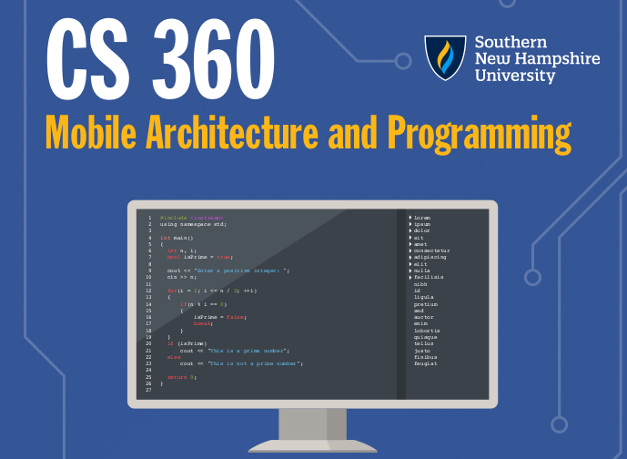
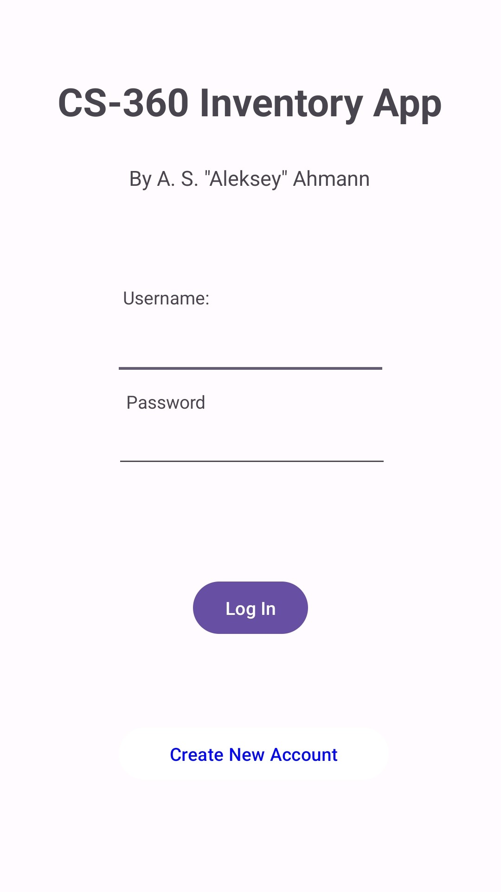
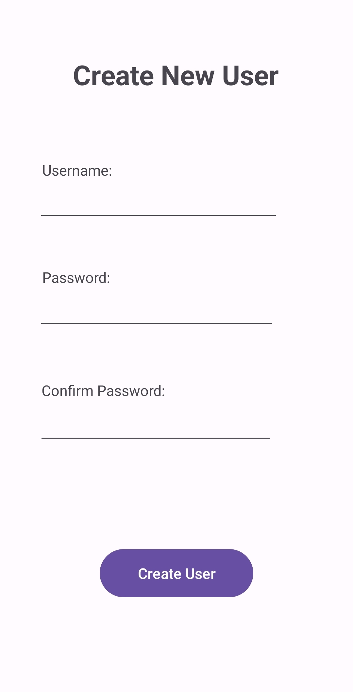
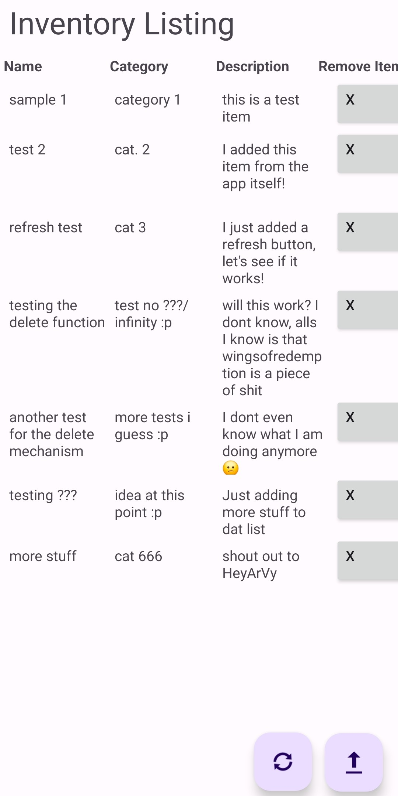
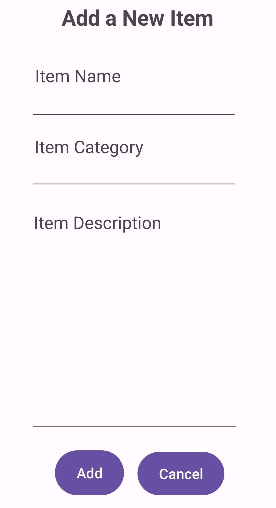
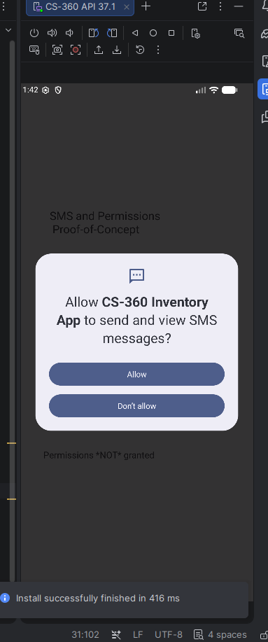

> "Students will apply mobile development principles and best practices to develop mobile applications using user-centered design principles and industry standards. Upon completion of a fully functional mobile application, students will conduct security, product assuredness, and compatibility checks before launching the application." ---[CS-360 Infographic](./images/CS%20360%20Course%20Overview%20Infographic.pdf).

In this course, I learnt about the basics of Mobile Architecture and Programming, with a focus on the Android platform. While I was not able to build a mobile phone application that went past the stages of a proof-of-concept and "alpha" stages of software development, I nonetheless have built a working protoype that can be built upon for problems regarding item management. This course's [syllabus](./images/CS%20360%Syllabus.pdf) and "[Essential Questions Infographic](./images/cs%360%Essential%Questions%Infographic.pdf)" further elaborates on the topics discussed, and given problems, given in this course.

## Course Project

For this class, I built an "inventory app" for keeping track of items in their respective warehouses. As outlined in the proposal ([Ahmann 2026a](./project/3-3_Proposal.pdf)), the target audience for this mobile application are primarily the managers and labourers who are in charge of material items in their respective inventories and warehouses. I intended for the inventory app to scale to large warehouses in a vast, interconnected network of warehouses, however the app has not been developed to the point that it supports that functionality.

The user interface that I developed still have its "kinks" in regards to its implementation. But I think that the basic minimalist design consisting of a simple ``TableLayout`` and by which to render tabular data, and floating action buttons to open up new activities that allow for the end user to add or remove items. __Note that__ I had not yet implemented functionality for updating the status of items (see [Ahmann 2026c](./project/7-2_notes.pdf)), something that needs to be implemented post-haste.

When writing the basic "back-end" logic for the user interface, I mainly referenced the Android Developer documentation, and a few dozen or so third-party article and videos tutorials as a reference for implementing the basic logic. As a result, there are some inconsistencies in [the codebase](./project/codebase) \(also see Ahmann [2026b](./project/5-2_notes.pdf), [2026c](./project/7-2_notes.pdf)\), and further refactoring will be needed to create harmony and uniformity in the coding style. But nonetheless, I was able to use some consistency, like camel case in naming variables, methods, and classes for the most part, and was able to compartmentalize some of the common procedures in the inventory app into their own Java methods, and I was also able to apply techniques of inheritance and other good object-oriented design principles.

To ensure that the code functions, I tested my Android application starting with both the _Android Emulator_, and then on my personal Android smartphone via the ``adb`` debug bridge through Android Studio. This is an important part of the software development process because it demonstrates that the software can work under specific circumstances, and that it can reveal potential runtime errors. 

When developing the inventory app, I had to "overcome" my tendency to build software for local workstations mainly with ``WinForms`` based applications, pre-HTML5 web development, and console applications. I treated this Android application a bit like developing a Windows Form application, and did not take screen orientation or responsive design into account. I mainly was able to show my experience with creating the programme logic, though even then, I did not totally understand the libraries (e.x.  ``SQLiteDatabase`` and ``SQLiteOpenHelper``). I also stored constants as Java code, when it would probably have been a better idea to store them in XML configuration files (there I go again with my "old school" approach to coding :p). 

### Project Files

<h3 style="color:red;">Please note: that this final project has several design and implementation problems, especially in regards to security. Use at your own risk.</h3>

* Ahmann, A. (2026a). [Project 1, Assignment 3-3: Proposal for an Inventory Application for the Android mobile phone](./project/3-3_Proposal.pdf).
* Ahmann, A. (2026b). [Notes while developing this app [5-2]](./project/5-2_notes.pdf).
* Ahmann, A. S. (2026c). [Note regarding the Inventory App [7-2]](./project/7-2_notes.pdf).
* Ahmann, A. (2026d). [CS-360— Assignment 7-2: Inventory Mobile Application Launch Plan](./project/7-2_launch.pdf).
* [Project Codebase](./project/codebase) \([ZIP Archive](./project/codebase.zip)\).

### Security Issues

The main problem is that passwords are stored in plaintext, and there is no role-based access controls, so every user account has the same privileges. There might also be SQL injections problems, though I am not quite sure. 

\[TODO: Expand on this subsection further\]

### Screenshots

These are screenshots of the Inventory App as they are running in either the _Android Emulator_ or my a real Android phone. To view a specific activity or other kind of screenshot, just click on the arrow or description of screenshot to expand it, 

  
Activity: Login Page

  

  
Activity: Create a New User

  

  
Database Shell: Items Table

  

  
Database Shell: Add a New Item

  

  
Activity: SMS Permissions Request

  

## Assignments

These are other homework assignments that I have done which are not directly related to the final project:

* [Assignment 1-4: Assessment of "Phyphox" mobile phone application](./assignments/1-4.pdf)
* [Assignment 2-2: Data Models in the Reddit Mobile Phone Application](./assignments/2-2.pdf): here, 
* [Assignment 3-2: Memorandum describing the creation of a simple Android application project](./assignments/3-2.pdf)
* [Assignment 4-4: Android User Interface Design](./assignments/4-4.pdf)
* Assignment 5-2: Basic Application Codebase: [ZIPped codebase](./assignments/5-2.zip)
* Assigment 6-3: Proof-of-Concept for Android’s Accelerometer Sensors \([writeup](./assignments/6-3/writeup.pdf), [ZIPped codebase](./assignments/codebase.zip)\)

## Resources

* Android Developers: https://developer.android.com/
    * Kotlin Overview: https://developer.android.com/kotlin/overview
    * Kotlin in Android: https://kotlinlang.org/docs/android-overview.html

